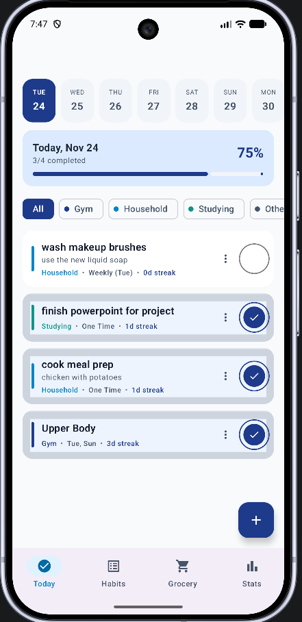
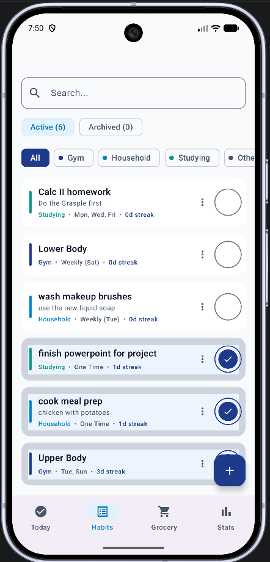
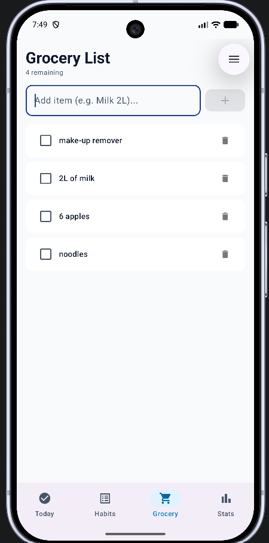
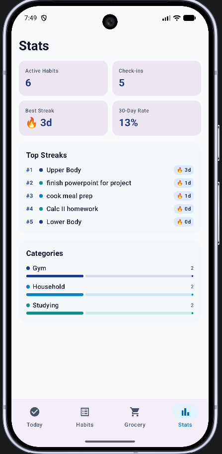

# Habit Tracker

An Android app I built for myself to get my studies and daily habits back on track. It lets me track habits day by day, see my progress over time, and keep a grocery list in the same place.


<p float="left">
  
  
  
  
</p>


## Why I built it

During my first year studies at TU Delft I noticed my routine was slipping. Studying, going to the gym and keeping up with household chores all kept getting pushed back. After being disappointed by my academic performance, I decided to overcome my lack of routine. I tried a few habit apps, but they were either full of features I didn't need (which usually made me lose interest in using them), locked behind a subscription, or wanted me to create an account. 

So I decided to build my own. I wanted something simple that I would actually open every day, and it was also a good excuse to learn modern Android development properly. I've been using it myself since May 2026, and it really helped me get back into a routine.

## Features

- **Today view**: tick off habits for the day, jump to other dates, and filter by category
- **All habits**: search, filter by category, and view archived habits
- **Add / edit / archive / delete** habits, each with a category, frequency and weekly target
- **Habit details**: tap a habit to see its history
- **Stats**: an overview of how consistent I've been, how many times I have checked into the app, what my best streak is and the number of active habits
- **Grocery list**: allows me to add products to the list by typing, check off the ones I've bought, and delete the ones I don't need anymore
- Data is saved locally on the phone, so no account or internet is needed

## Design choices

**Kotlin + Jetpack Compose.** Compose is what Google now recommends for new Android apps, so I wanted to learn it instead of the older XML layouts. Writing the UI as functions also made it much quicker to change screens around while I was figuring out what I actually wanted.

**MVVM architecture.** All the app's state lives in one `HabitViewModel`, and the screens only display it and report what the user tapped. I chose this because:
- the screens stay simple and don't contain logic
- the state survives things like rotating the phone
- the logic can be tested without running the UI

**One UI state object.** Instead of lots of separate variables, everything the UI needs (active tab, selected date, filters, open dialogs) sits in a single `HabitTrackerUiState`. That way there's one source of truth, and it's easy to see what the screen should look like at any moment.

**Repository layer.** The ViewModel doesn't know *how* data is saved. It just talks to the repository. If I ever want to move to a proper database or add cloud sync, I only need to change that one part.

**Archiving instead of only deleting.** Sometimes I stop a habit for a while (like during exams) but don't want to lose its history. Archiving hides it without deleting anything.

**Grocery list in the same app.** Shopping was one of the "habits" I kept forgetting, and I didn't want a separate app just for a list.

**Adaptive navigation.** I used `NavigationSuiteScaffold`, so the tabs show as a bottom bar on phones and switch to a side rail on bigger screens like tablets automatically.

## Testing

**Manual testing.** I tested the app on the Android Studio emulator (Pixel 10 Pro) and went through the main flows:
- adding, editing, archiving and deleting habits
- ticking habits off on different dates and checking the stats update
- search and category filters
- adding, ticking and clearing grocery items
- closing and reopening the app to check the data is still saved

**Real use.**
- I've used it every day from May to November, which is how I found out what was missing or annoying. I kept adding the features I actually needed and keep it clean and uncluttered at the same time.
- While the app was for my own personal usage at first, I wanted other people to test it as well, so I asked friends and family if they would be up to using it for a small period of time and provide feedback. It proved to be quite useful for other users as well.

## Built with

- Kotlin
- Jetpack Compose + Material 3
- Android ViewModel (MVVM)
- JUnit

## Project structure

```
app/src/main/java/com/miruna/habittracker/
├── MainActivity.kt   # app entry point + tab navigation
├── data/             # repository / local storage
├── model/            # Habit, HabitCategory, HabitFrequency
└── ui/               # screens, dialogs, ViewModel, theme
```

## Running it

1. Clone the repo
   ```
   git clone https://github.com/mirunadobrescu06/Habit-Tracker.git
   ```
2. Open it in Android Studio
3. Run it on an emulator or an Android phone

## What I learned

- Structuring an app with MVVM so the UI and the logic stay separate
- Building UIs in Jetpack Compose and managing state
- UI design: keeping the app simple enough that I'd actually want to open it every day
- Testing my code, and using Git and GitHub to publish a project

## What I'd add next

- Reminders / notifications
- A home screen widget
- Exporting data
- **Syncing across devices:** storing the data online, so I could use the app on my phone and laptop at the same time
- **Other platforms:** I'd like to bring the app to iOS, and possibly to Windows and macOS. Kotlin Multiplatform looks like a good way to do this, since most of the code could be shared instead of rewriting the app for each platform.
